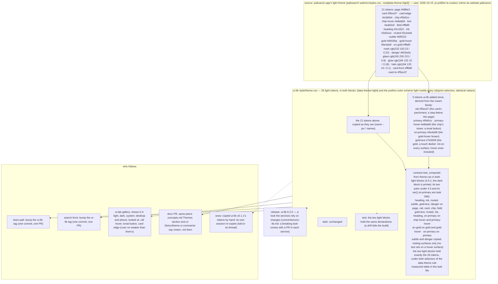

# 065 the light theme is palicanon.app's cream

status: merged · rank: 5 · level: standard · type: feature · request: user, 2026-10-15 ("je préfère la couleur crème du website palicanon") · session: ui-lib-065-cream-palette · repos: ui-lib, ui-lab (gallery); bumps in learn-pali, search-front · process: ../../docs/workflows/development-process.mmd

## Summary
Re-ranked 5 at review round 2 (a second round). Rank (rank.md): difficulty 3 (25 tokens: 20 copied from a known palette with the same names, 5 derived; contrast measured), impact 6 (the look of every site in light; a release the services bump) → 4.
Asked: the user compared learn.palicanon.app and search.palicanon.app (ui-lib's linen, #f8f6f0, white cards, since ui-lab 023 on 2026-10-04) with palicanon.app (the old React site, palisearch web/src/styles.css, cream #fdf6e3) and prefers the cream. Two options were shown: replace the light theme (taken) or add a third Sepia theme (not taken).
Decided (v1, to reach consensus): ui-lib's light tokens become the old site's light block (same --ps-* names), in both places theme.css defines light (the [data-theme=light] block and the prefers-color-scheme light media query); the five tokens ui-lib added since are derived from the same family (rail, primary, primary-hover, on-primary, gold-text); dark is unchanged; every text token meets WCAG AA on its backgrounds, measured. A look the services rely on changes, so the release is 0.2.0 and each service gets its bump commit (learn-pali, search-front); www copied v0.1.1's tokens and re-copies through its own session.
Open: the release number; whether the comments and docs that name linen change with it.

## Workflow

## Log
| Step | Result | Output |
| --- | --- | --- |
| Define | doing | orchestrator, 2026-10-15: session ui-lib-065-cream-palette (design dcfbe722603094c v1, discussion d5d2dceba970943, process d4994f98ce89b4a); worktrees /Users/lsh/projects/palicanon/wt/065/ui-lib and wt/065/ui-lab (feat/cream-palette) |
| Define (consensus) | done | consensus agent, round 1, v2 (#7034): 26 light tokens (21 copied, 5 derived; gold-text #7e5509, v1's #84590a failed AA on hover surfaces, 4.44); contrast table computed; a test that the two light blocks are equal; the contrast test widened to every text × surface; 0.2.0 + a bump in learn-pali and search-front; comments and concepts.md that name linen change. Voices: sage (a review on the second ask), deep empty twice, gemini 429 |
| Define (user) | done | user, 2026-10-15: "on passe sur la couleur du palicanon" — v2 validated |
| Plan | done | orchestrator: one slice (style/theme.css, src/theme.rs, Cargo.toml 0.2.0, README/CHANGELOG if they name the palette); the gallery (ui-lab) needs no code: it is checked at Check; learn-pali and search-front bumps after the tag |
| Build | done | lane:palette (Sonnet): a9e4977 (theme.css both light blocks, theme.rs tests), 2705003 (0.2.0); red: on-gold on gold 3.95, gold-text on primary-hover 4.45 against linen; fmt, leptosfmt, clippy ssr + hydrate, 427 tests, doc — all 0. Dark matrix printed: subtle on card 4.43, danger on card 4.39 → task 066 opened |
| Check (orchestrator) | done | gallery on :3065 from wt/065 (ui-lib a9e4977+2705003): CSS serves #fdf6e3; CDP captures desktop 1280 and phone 390×844 of /, /cards, /buttons: scrollWidth = innerWidth everywhere |
| Review round 1 | fail | deep #7285, sage #7300: R1–R6 (Reviews); re-ranked stays 4 (findings low) |
| Fix round 1 | done | lane:fix1 76145bc: both selectors, == 26, the figure dropped; red by mutation; 428 tests |
| Review round 2 | fail | deep #7336: S1–S3 taken in (one golden test), S4–S6 noted or ruled out; re-ranked 4 → 5 |
| Fix round 2 | done | lane:fix2 b26ce2e: LIGHT_TOKENS (the design's 26), each light block equals it exactly, one light rule; red by three mutations; 430 tests |
| Review round 3 | done | deep #7370: no vacuous pass; formatting-level bypasses and the source comparison open → the user |
| Check (user) | done | user, 2026-10-15: "merge la lib ui" — after the gallery on :3065 (wt/065, ui-lib b26ce2e), cream served (#fdf6e3); the round-3 open points accepted |
| Merge | done | 52c050a on main (squash), tagged v0.2.0 on it, pushed; the services' bumps next (learn-pali, search-front) |
| Retro | done | retro #7427 (8 errors), gemini #7430 (third try). Lessons: a-relative-worktree-path-landed-inside-the-repo, each-guard-test-names-the-mutation-it-catches; docs 82b520d (git.md: absolute worktree paths, another session's edit set aside by path, servers stopped by pid), 913f555 (build.md: a guard test red by mutating what it guards) |

## Design
Viewer: ui-lib-065-cream-palette/design (dcfbe722603094c), v3 — v2 validated by the user 2026-10-15; v3 = review round 1's wording (the dark block's assertion moves to 066).

## Lanes

## Reviews

### Round 3 (last) — 2026-10-15
deep #7370 (summons #7368): S1–S3 done, nothing passes vacuously. Open at the last round, to the user: a minified or single-selector light rule appended later escapes the byte-exact count (needs a CSS parser); the media block could leave its `@media` unseen (a one-line test, recommended); LIGHT_TOKENS is not compared to palicanon.app's styles.css (another repository, to be retired); doc notes on the `--ps-*` filter and whitespace-normalised values. The user: "merge la lib ui" (2026-10-15) — merged as is, the open points accepted.

### Round 2 — 2026-10-15
deep #7336 (posted by the orchestrator, summons #7335): R3–R5 do what the rulings say; but:
| # | Finding | Ruling | Fix |
| --- | --- | --- | --- |
| S1 | a second light rule appended later wins the cascade; `contains`/`find` see only the first | taken in | exactly one light rule (`matches(opener).count() == 1`) |
| S2 | `== 26` counts declarations: a token removed and another repeated passes | taken in | with S3: the name set equals the design's 26 names |
| S3 | no test pins the values to the design: two identically wrong blocks pass | taken in | one test: each light block equals the design's 26 name → value table (task file, design v3), exactly |
| S4 | the kept gold-text test does assert the dark block (gold-text × 4 backgrounds) | noted, no change (R1's wording stands: the rest of dark is 066's) | |
| S5 | the review graph still shows d6 v2 | noted: the design is v3 | |
| S6 | nothing stops a component putting subtle text on a hover surface | ruled out: a component's review, not the palette's | |

### Round 1 — 2026-10-15
Review entry dfea62e21910546; deep #7285 and sage #7300 (independent, Deep outside its window), both reviews; gemini 429.
| # | Finding | Ruling | Fix |
| --- | --- | --- | --- |
| R1 | deep, sage: d6 said "all 3 blocks"; the dark block is printed, not asserted | taken in as wording (v3): 065 asserts the light blocks; the dark block's two pairs under 4.5 are task 066, which adds the dark assertion once fixed | design v3 |
| R2 | deep: dark on-primary is a var(), no coverage | to 066 | |
| R3 | deep: deleting the subtree selector `[data-theme="light"] {` leaves the tests green | taken in | a test: both selectors of the rule are present |
| R4 | deep: `>= 26` passes a 27th token added to both blocks | taken in | `== 26` |
| R5 | deep: the 4.32 figure in a comment rots silently | taken in | the figure removed from the comment |
| R6 | deep: line and card-edge cues weaker (line on card 1.11, card-edge on card 1.25) | ruled out as a test: a visual judgment, shown to the user at Check (it was already one of the three points to look at) | |

## Merge
52c050a on main, tag v0.2.0, 2026-10-15.

## Retro
Retro 065 validated 2026-10-15 (retro-discussion df4dbcea346e445). Two lessons: worktree paths are absolute, another session's uncommitted edit is set aside by path and restored identical, a server is stopped by its pid after reading its cwd; a guard test is shown red by mutating what it guards and names what it does not catch. Not carried: Gemini's suggestions of new scripts (a worktree script, an ephemeral clone per task, a token pipeline) — the rules above cover the errors without new tooling; the dark block is task 066; LIGHT_TOKENS stands as the reference (the old site retires).
