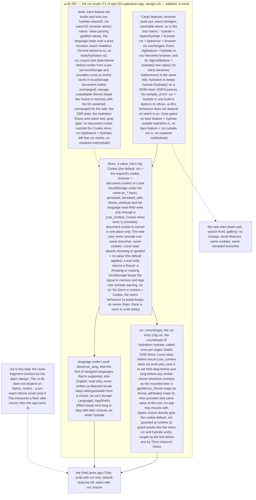

# 067 ui-lib runs client side only: the csr mode

status: merged · rank: 7 · level: standard · type: feature · request: app-001-palicanon-app T2 (user, 2026-10-15: "le mode sans server dans ui lib") · session: ui-lib-067-csr · after: [065]

## Summary
Rank (rank.md): difficulty 5 (a feature split across ~17 files, persisted preferences without cookies, a pre-wasm script, three build modes to keep green), impact 5 (every Leptos consumer's build modes; the app's first dependency) → 5.
Why: the PaliCanon app (Tauri 2) has no server: its WebAssembly builds the page from an empty document (Leptos `csr`), and its webview keeps no cookies (learn-pali spike 044). ui-lib today knows `ssr` (server render; theme and language read from cookies) and `hydrate` (the browser takes the server's HTML over). Its components are generic; only persisted, language and theme depend on the server, plus hydration.rs for the web.
Design v3 (consensus): a private `browser` feature shared by `hydrate` and a new `csr`; one `Store` owns the preferences' read and write — `Cookie` by default (the web, unchanged), `Local` (localStorage) provided by `csr::mount` through Leptos context, so a build where csr and hydrate unify stays correct; `csr::mount` sets `data-theme` and `lang` before mounting (the counterpart of `hydration::hydrate`); the language from localStorage, then the first supported `navigator.languages` entry (read, never written); a failed `Local` write returns an `Err`, keeps the signal in memory and warns once; the ~20 `not(hydrate)` twins become `not(browser)`, guarded by three grep gates; `tests/csr.rs` in headless Chrome; additive; a minor release. Moved out (v2): the pre-wasm theme script (T5a owns one if it measures a flash) and the route-fragment contract (ui-lib does not depend on leptos_router: the app's design T5a).
Evidence: learn-pali spike 044's branch spike/csr in /Users/lsh/projects/palicanon/wt/044/ui-lib (9e4b0d3, 5d0c36b).

## Workflow

```mermaid
flowchart LR
  Define["Define ✓ v3 validated"]:::done --> Plan["Plan ✓ one lane, three steps"]:::done --> Build["Build ✓ 4 commits, red proofs"]:::done --> Verify["Verify ✓ 442+4+1 native, 3+4 wasm"]:::done --> Review["Review ✓ 3 rounds, last fix ruled by the user"]:::done --> Check["Check ✓ orchestrator, local CI list"]:::done --> Merge["Merge ✓ 566843d, v0.3.0"]:::done --> Retro["Retro ✓ validated"]:::done
  classDef doing fill:#f9a825,color:#000
  classDef done fill:#2e7d32,color:#fff
  classDef todo fill:#9e9e9e,color:#fff
```

## Log
| Step | Result | Output |
| --- | --- | --- |
| Define | doing | orchestrator, 2026-10-15: session ui-lib-067-csr (design dabbfe338612646 v1, discussion dd4c480bb3bb243, process d68945fcea9a24a); worktree /Users/lsh/projects/palicanon/wt/067/ui-lib (feat/csr) |
| Define (consensus) | done | consensus agent, 2 rounds, v3 (deep, sage; gemini 429 ×3): one Store (Cookie default, Local by csr::mount), attributes before mount, Err on a failed write, grep gates, tests/csr.rs; the script and the route contract moved out |
| Define (user) | done | user, 2026-10-16: "mode sans server de l'ui lib tu peux le faire" — v3 validated |
| Plan | done | orchestrator: one Sonnet lane (the files overlap: persisted, language, theme are touched by both the feature split and the Store), three committed steps: (1) features browser/csr + the cfg rename + grep gates; (2) the Store (Cookie default, Local) through persisted, theme, language; (3) csr::mount + tests/csr.rs; then 0.3.0 |
| Build | done | lane:csr (Sonnet): b9e63e8 features + cfg rename + grep gates; 176c55a Store; 8c811a6 csr::mount + tests/csr.rs; f3c52de 0.3.0. Red proofs: cfg_gates failing on the old tree; E0425/E0433 before Store; E0432 before csr; mutation (set_page_attributes removed) → `set before the render: left: None, right: Some("dark")`. All checks exit 0 (fmt, leptosfmt, clippy ssr/hydrate/csr/browser, tests, wasm hydration 3, wasm csr 4, rustdoc ssr) |
| Verify | done | orchestrator, 2026-10-16, on f3c52de: `cargo test --locked --features ssr` → 442, 4, 1 passed, 0 failed; worktree clean; 27 files, +1034 −161 |
| Rulings | done | orchestrator on the lane's deviations: (1) module declarations without a bare cfg (`#![cfg(feature = "csr")]` inside csr.rs) — accepted, it keeps the gates simple; (2) one console warning per page load, not per failure — accepted (no console flood); (3) Store a Copy enum, localStorage looked up per access — accepted, v3's "one value" holds; (4) Store::current/read/write, StoreError public, set_cookie now returns Err — accepted, additive; (5) README tag v0.3.0 before the tag exists — accepted, the tag is cut at the merge; (6) the warning itself not asserted — accepted (console capture is fragile), the Err and the in-memory signal are. Found: rustdoc on wasm32 fails on language.rs:3,17 — pre-existing, already task 064 (other session); 064 told csr is affected too |
| Re-rank | 5 → 6 | a new test harness (tests/csr.rs, tests/cfg_gates.rs, a CI job) and a pre-existing bug met (064) |
| Review 1 | fail | reviewer: diagram d073ee12307824b v1; voices: sage 8130/8166 (nothing), gemini 8181/8196 (nothing, no reasoning), deep 8211/8239 (5 Δ, 6 T). Rulings in ## Reviews; Fix round 1 |
| Re-rank | 6 → 7 | a review round with medium findings (deep) |
| Rule (user) | — | 2026-10-16, GitHub Actions minutes exhausted: "Merge si les tests passent en local" — the CI list of README "Checks" is run locally in full before the merge, its output in the Log |
| Fix 1 | done | lane:csr-fix (Sonnet): e72087d F7, 379e6fb F1, a347b5f F5, bd4c4dc F8, 04bc161 F3, 2ecf271 F2/F3/F4/F6, 4104dcd F9, 11f8696 clippy; red or mutation per item. Local CI list (user rule), tip 11f8696: fmt 0, leptosfmt 0, clippy ssr/hydrate/csr/browser 0, tests ssr 445+8+1, wasm hydration 3, wasm csr 6, rustdoc ssr 0, llvm-cov 97.43% lines. Deviation accepted: several mounts per csr test binary, each in its own #root |
| Review 2 | fail | reviewer: d073ee12307824b v2; deep 8351: F1–F9 answered (F6 nominal), 5 new Δ, 6 new T; sage 8378: all answered, nothing new (thin, gpt-oss-20b). Rulings in ### Round 3 — 2026-10-16
Voices: deep 8420, sage 8433. Ruled by the user ("Dernière correction"): a last fix, no fourth round.
- H1 (deep Δ1) taken in: the unpaired gate catches `not(any(feature = "hydrate", …))` and `not(all(…))` again (any negation that contains `feature = "hydrate"`), with a string test for each form.
- H2 (deep Δ2) taken in: `declaration_is_gated` accepts a compound gate that requires the feature (`all(feature = "hydrate", …)`), refuses `any(…)` and `cfg_attr`; string tests for both.
- H3 (deep T, G3 partly) taken in: `reset()` also removes `<html>` `data-theme` and `lang`.
- H4 (deep T) taken in: after storage works again, a theme choice lands in `pc_theme`.
- H5 (deep Δ3) taken in: `reset()`'s doc says what it does now.
- Ruled out: the console-warning test (ruling 6 of the build: console capture is fragile; the Err and the signal are asserted); deep's "gate catching a real src line" (the gates scan src/ on every run: today's tree is that test); sage's two T (covered by F3 and the theme_attribute test of round 1).

### Round 2; Fix round 2 (the last round before the user) |
| Fix 2 | done | lane:csr-fix: 30791cf G4, 521fb22 G3/G5/G6, 04cca85 G1/G2, 020532e clippy; red or mutation per item. G3 deviation accepted (orchestrator): a wasm panic does not unwind, so Drop never runs; the guard stays and reset() restores storage at each test's start (probe: a forced failure fails only its own test). Local CI list at 020532e: fmt 0, leptosfmt 0, clippy ×4 0, tests ssr 445+10+1, wasm hydration 3, wasm csr 8, rustdoc 0, llvm-cov 97.43% |
| Review 3 | fail | reviewer: d073ee12307824b v3; deep 8420: G1, G2, G4–G6 answered, G3 partly; 3 Δ, 4 T (all in the test gates and test isolation, none in src/); sage 8433: all answered, 3 T. Open at the third round: to the user (process.md, Review) |
| Rule (user) | — | 2026-10-16, on round 3's open findings: "Dernière correction" — one last fix (H1–H5 below), the local CI list again, then merge and tag v0.3.0 with no fourth voice round |
| Fix 3 | done | lane:csr-fix: 93501e1 H1/H2, d34f24f H3/H4/H5; red or mutation per item. Local CI list at d34f24f: fmt 0, leptosfmt 0, clippy ssr/hydrate/csr/browser 0, tests ssr 445+11+1, wasm hydration 3, wasm csr 9, rustdoc ssr 0, llvm-cov 97.43% |
| Check | done | orchestrator, 2026-10-16, on d34f24f (no visible UI: the orchestrator checks): `cargo test --locked --features ssr` 445+11+1 passed, fmt exit 0; GitHub Actions unavailable (minutes exhausted), the local list stands for CI (user rule) |
| Merge | done | 566843d on main (squash), tag v0.3.0 on it, pushed; CI on GitHub not run (Actions minutes exhausted) |

## Design
Viewer: ui-lib-067-csr/design (dabbfe338612646), v3 — consensus 2026-10-15 (deep, sage; gemini 429), validated by the user 2026-10-16 ("mode sans server de l'ui lib tu peux le faire").

## Lanes

## Reviews

### Round 2 — 2026-10-16
Voices: deep 8351 (F1–F9 answered; new items below), sage 8378 (all answered, nothing new). Rulings (orchestrator):
- G1 (deep T1) taken in: a stored `pc_lang` beats the detected `navigator.languages` (a test; v3's order).
- G2 (deep T3) taken in: a garbled `pc_theme` in localStorage at `csr::mount` gives the same `data-theme` as `theme_attribute()` gives it (v3's words; a browser test).
- G3 (deep Δ3) taken in: the throwing-storage stub is restored by a guard whose Drop restores it, so a failing test cannot leave later tests' storage throwing.
- G4 (deep Δ1, Δ2, T6) taken in: the reverse gates refuse `cfg_attr` (only a plain `#![cfg(feature = "csr")]` / `#[cfg(feature = "hydrate")]` counts); `not\s*\(` tolerates spaces; a gate test with the spaced form shows it bites.
- G5 (deep T5) taken in: after the guard restores storage, a language choice lands in `pc_lang`.
- G6 (deep Δ4) taken in as a comment: tests/csr.rs's header says `<html>` attributes are page-global, so each test sets the values it asserts.
- Ruled out — deep T2 (first render before any tick): the build's mutation (set_page_attributes removed → `set before the render: left: None`) already shows the test asserts before render. Deep T4 (`leptos::mount` gives Cookie): F5 asserts `Store::current()` without context is Cookie, which is what `leptos::mount` leaves. Deep F6 "nominal": the round-1 ruling asked one smoke; the renamed branches are a pure `hydrate`→`browser` rename, gated by cfg_gates. Deep Δ5 (a third public path to the cookie helpers): wording; kept for compatibility, documented in store.rs.

### Round 1 — 2026-10-16
Voices: deep (8211, 8239), sage (8130, 8166: no finding, no reasoning), gemini (8181, 8196: none, no reasoning). Rulings (orchestrator):
- F1 (deep A2, Δ) taken in: a failed **Cookie** write keeps the old behaviour on the web (the result ignored, no warning); `warn_once` fires for Local only — v3: "the web sites: same branches".
- F2 (deep A3, A4, Δ+T) taken in: a browser test mounts through `csr::mount` with localStorage throwing (a stub that throws on getItem/setItem) — the app renders with the defaults, a choice stays in its signal; the `Err` itself stays asserted at `Store::write` level.
- F3 (deep A5, T) taken in: `pick_language` over an empty `navigator.languages` and over only unsupported entries → English; after `csr::mount` with no stored `pc_lang`, `localStorage.getItem("pc_lang")` is null (detection never written).
- F4 (deep A6, T) taken in: a language choice under Local lands in `localStorage` `pc_lang`, `document.cookie` unchanged, `<html lang>` updated.
- F5 (deep B3, T) taken in: `Store::current()` with no Store in context is `Cookie` (a test).
- F6 (deep B2, T) taken in, one smoke: under csr, one component whose code went through the rename (e.g. the theme toggle or a Dialog) mounts and reacts to a click.
- F7 (deep B4, Δ) taken in: no cycle — `cookie_assignment` and `cookie_value` move from persisted.rs to store.rs (document.cookie is the Cookie store's anyway); persisted uses store only.
- F8 (deep B5, Δ) taken in: the gates match `feature\s*=\s*"hydrate"` / `"csr"` (whitespace-tolerant, cfg_attr included); and the reverse: hydration.rs starts with `#![cfg(feature = "hydrate")]` and csr.rs with `#![cfg(feature = "csr")]` (or their declarations carry it) — a test.
- F9 (deep B6, wording) taken in: README and csr::mount doc say "before the first render", not "before the first paint" (the attributes are set once the wasm runs).
- Ruled out — deep A1 (the `pub use hydration::*` glob widens exports): today it exports exactly main's five items (APP_ROOT_ID, HydrationRoot, MissingRoot, app_root, hydrate); kept, with a doc comment that hydration.rs's `pub` items are the crate's API.
- Ruled out — deep B1 (gate `Store::Local` to csr.rs): v3's consensus ruled it (a web site that provides Local made that choice; no guard), unchanged.

## Merge
566843d (v0.3.0)

## Retro
Retro agent: retro-discussion d62a3cb9e3dd447, summary 8484; voice gemini 8560 (retry of a 429). Validated by the orchestrator, 2026-10-16:
- The same clippy lint slipped in twice (clippy run on one feature set) → docs prompts/steps/build.md: clippy on every feature set CI lints, before each commit (docs 8a65f08).
- The reviewer printed GET /settings and /ai/status whole (credential labels) → prompts/review.md: read them through a filter, never whole (8a65f08); the user told to rotate the key.
- A wasm test panic does not unwind: Drop-based cleanup failed later tests → lesson 2026-10-16-a-wasm-test-panic-does-not-unwind (8a65f08).
- Three review rounds, deep finding new test gaps each time; sage and gemini answered without reasoning → kept as is: deep's findings were real; the thin answers are already counted as no review (process.md).
- A wrong `!` in the squash message, caught before the push; GitHub Actions minutes exhausted, the local CI list stood in (user rule) → no change.

