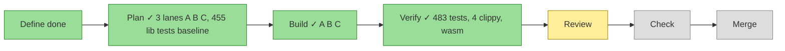

# 070 The phone shell: a menu button, popup dialogs, aligned rows

status: planned · rank: 3 · level: standard · type: feat · session: ui-lib-070-phone-shell · request: the user, 2026-10-22 (phone check of learn.palicanon.app)

## Summary
Rank: difficulty 3 (three small shell items, one new Dialog prop, render tests, gallery), impact 3 (every service's phone shell) → 3.
Three things the user saw on the phone: (A) the lotus is the only way to open the navigation and nothing says it is a button → a menu button at the bar's right; (B) 'Stop here?' fills the phone like every Dialog → a `size` prop, `Popup` opt-in (centred at every width), `Sheet` default unchanged; (C) the language row of the phone navigation is 14 px left and 8 px shorter than the other rows → one row class for every entry. Additive: services build unchanged; learn-pali then opts its StopDialog into Popup (its own light task).
Consensus 2026-10-22 (v3: gemini 13194/13244, deep 13221/13246, sage 13224/13299; summary 13301). The user validated v3 and answered: the lotus is the brand only on the phone (inert); the open menu stays full screen with its ✕. Root cause of C found in the code: `Size::Md` on the language row vs `Size::Lg` on the others, and `item_row`'s fixed `gap-3`. Follow-up (not 070): focus management of `#pc-menu`. After the merge: learn-pali's light task sets StopDialog `size=Popup`.

## Workflow

## Log
| Step | Result | Output |
| --- | --- | --- |
| Define | done | design v3 at consensus, validated by the user 2026-10-22 |
| Plan | done | 3 lanes A (shell.rs), B (dialog.rs, lib.rs), C (menu.rs, language_menu.rs); overlap: feat/segmented-slide touches shell.rs, lib.rs, README.md (whoever merges second rebases); baseline 455 lib + 11 + 1 doctest, ssr, exit 0; lanes spawned through main |
| Build | done | lane A 59ceec7 (shell.rs, +9 tests), B b8158f0 (dialog.rs, lib.rs, golden fixture, +11), C 0c6287d (menu.rs, language_menu.rs, +7); each red on assertions first, mutations tried, checks 1-8 exit 0 in its worktree (wt/070/ui-lib-a|b|c) |
| Verify | done | cherry-picked b598e0f, f1fdb8f, bb78402 on feat/phone-shell; lead's pair test 61e2e93 (red when mobile_language goes back to Md: exit 101), docs d05e146 (README, lib.rs). On the tip d05e146: fmt, leptosfmt, clippy ssr/hydrate/csr/browser, `cargo test --locked --features ssr` (483 lib + 11 cfg_gates + 1 doctest passed), `RUSTDOCFLAGS=-D warnings cargo doc`: all exit 0; hydration wasm test 3 passed exit 0, csr wasm test 9 passed exit 0 (chromedriver 053). Merge order: this branch before feat/segmented-slide (shell.rs, lib.rs, README.md), which rebases. |
| Fix 1 | done | 5593ccb (tests F2), c3b607e (README F1); F3 rebased on origin/main 361e573 with no conflict (14 commits replayed); red by mutation: item_row's Sm/other fallback gap-3 -> gap-4 (item_row_at_the_small_size_keeps_the_gap_of_the_medium_row, exit 101), Brand box size-11 -> size-10 (the_brand_lotus_box_is_a_centred_44_px_box, exit 101), MenuButton label_open=close -> open (the_menu_button_of_an_open_navigation_is_expanded_and_says_close, exit 101), each undone (git diff checked); checks on c3b607e: fmt 0, leptosfmt 0, clippy ssr/hydrate/csr/browser 0/0/0/0, `cargo test --locked --features ssr` 491 lib + 11 cfg_gates + 1 doctest passed exit 0 (483 lib before: +3 here, +5 from main), `RUSTDOCFLAGS=-D warnings cargo doc` 0, hydration wasm 3 passed exit 0, csr wasm 9 passed exit 0 |
| Fix 2 | done | b4cdb59 (tests F4, F5, F6), fce6481 (docs F7); red by mutation: Brand box img wrapped in a span (the_brand_lotus_box_is_a_centred_44_px_box, exit 101 on the new ends_with assertion at shell.rs:1839), `hidden=move \|\| !menu_open.get()` inverted (the_menu_has_no_hidden_attribute_only_when_open, exit 101), MenuButton label_closed/label_open swapped (the_open_menu_button_says_close_in_french, exit 101), each undone (cmp against a copy); the first F5 draft matched `hidden` in the `sm:hidden` class and was red unmutated, fixed to ` hidden`; checks on fce6481: fmt 0, leptosfmt 0, clippy ssr/hydrate/csr/browser 0/0/0/0, `cargo test --locked --features ssr` 493 lib (491 before, +2 new tests; F4 extends an existing one) + 11 cfg_gates + 1 doctest passed exit 0, `RUSTDOCFLAGS=-D warnings cargo doc` 0, hydration wasm 3 passed exit 0, csr wasm 9 passed exit 0 |

## Design
Viewer: ui-lib-070-phone-shell/design (d8749f24458ba4d), v3, consensus and user validation 2026-10-22.

```mermaid
flowchart TB
  subgraph a["A. The phone bar's menu button (shell.rs)"]
    a1["today: the phone bar is LotusToggle (DisclosureButton, Icon Md 44 px, 'Open navigation') + Wordmark + env badge; the open #pc-menu (role=dialog, aria-modal) has its own header: LotusToggle (closes), Wordmark, a close cross at the right. On desktop the lotus opens the rail (unchanged)"]
    a2["design: the phone bar = brand (lotus image + wordmark, NOT interactive, NOT a link: the shell has no home URL) at the left; one right-hand group `ml-auto flex min-w-0 items-center gap-2` = env badge (min-w-0, max-w-[8rem], truncates first) then the menu button (shrink-0, never overlapped). The menu button = DisclosureButton variant Icon, size Md (size-11 = 44 px), icon IconName::Menu, controls pc-menu: aria-expanded + aria-controls; name = the existing strings 'Open navigation' / 'Close navigation' (no new catalogue key; the label swap never reaches a user, the bar is covered while open). The role MOVES in the same change: the lotus in the bar is no longer a button, so exactly one control opens pc-menu"]
    a3["open navigation: header = brand (lotus + wordmark, not a button) at the left, the existing close cross at the right (named 'Close navigation'); Escape rules and the Settings-from-navigation behaviour unchanged"]
    a1 --> a2 --> a3
  end
  subgraph b["B. Small dialogs are popups on the phone (dialog.rs)"]
    b1["today: PANEL = h-full w-full ... sm:h-auto sm:max-h-[85vh] sm:max-w-[40rem] sm:rounded-2xl; wrapper sm:p-4; 'Stop here?' (learn-pali StopDialog, layout sm:max-w-md) fills the phone"]
    b2["design: `#[derive(Default)] pub enum DialogSize { #[default] Sheet, Popup }` and an optional `size` prop on Dialog; two COMPLETE class sets picked by the enum, never concatenated (no h-full + sm:h-auto pairs). Sheet = today's PANEL and wrapper sm:p-4, byte for byte. Popup = wrapper `p-4` (the ONLY owner of the inset), panel `flex w-full max-w-md max-h-[85dvh] flex-col overflow-hidden rounded-2xl border border-line bg-card shadow-lg` (overflow-hidden is what makes the rounded frame a frame, as in Sheet) (dvh: the visible viewport, so the footer stays reachable under a phone URL bar and in landscape); header and footer shrink-0 and the body flex-1 min-h-0 overflow-y-auto as today. Same role, aria-modal, focus_trap, Escape, backdrop and close cross for both. `layout` is still appended for margins and position; WIDTH belongs to the size: a Popup's doc says a caller never passes a max-w, and a test asserts the Popup panel carries exactly one max-w-* utility. Popup is max-w-md so learn-pali's StopDialog keeps its width on desktop"]
    b3["consumers: additive, a service that never sets `size` renders the same bytes. learn-pali (own light task): StopDialog drops layout=sm:max-w-md and sets size=Popup. Settings stays a Sheet. Enforcement sits on the caller: learn-pali's task tests that StopDialog sets size=Popup and passes no max-w in layout"]
    b1 --> b2 --> b3
  end
  subgraph c["C. The phone navigation's rows aligned (shell.rs, language_menu.rs, menu.rs)"]
    c1["root cause (read in the code): mobile_language builds its row with Variant::Nav Size::Md (h-11 gap-3 px-[13px]) while the NavList rows (MobileSections) and MobileSettings use Size::Lg (h-13 gap-4 px-4); item_row also wraps icon + label in a span with a fixed gap-3, so the text would still sit 4 px short at Lg. Measured on learn.palicanon.app at 390 px: Lg rows icon x 73 / text x 124 / h 52; the language row icon x 68 / text x 110 / h 44"]
    c2["design: item_row, BackRow and leaf_item take a row size (default Md: the desktop Menu and DrillMenu render the same bytes); item_row's gap follows it (gap-3 at Md, gap-4 at Lg). mobile_language passes Size::Lg for its row, the Back row and the drilled choices (CheckMark / chevron stay at the right edge). Result: one row geometry for the language row, NavList entries and Settings at every drill level"]
    c1 --> c2
  end
  t["tests (SSR render): A the phone bar has exactly one control with aria-controls=pc-menu, it carries the Menu icon, aria-expanded=false and size-11, and the lotus image is not inside a button in the bar; the open navigation keeps its close cross; the env badge stays truncating and before the button. B Sheet default keeps today's panel string; Popup has w-full max-w-md max-h-[85dvh] overflow-hidden rounded-2xl, no h-full, no sm: pairs, exactly one max-w-*, wrapper p-4; Popup keeps role, aria-labelledby, close cross, footer; layout still joins. C the language row, a NavList entry and the Settings row share the classes(Variant::Nav, Size::Lg) string, also drilled (Back row and choices); DrillMenu/Menu unchanged at Md. Before the user check, the orchestrator measures at 390 px (CDP): icon x and text x equal across the rows, and the menu button's box is 44 px. Gallery: the Dialog section shows Sheet and Popup, the shell section at phone width"]
  f["followup (out of scope, own task): pc-menu is not managed by focus_trap, so opening it moves no focus, Tab walks the page behind and closing restores nothing. Managing it as a Dialog would make Settings REPLACE the navigation, which the Escape tests forbid, so it needs its own design"]
  a3 -.-> t
  b3 -.-> t
  c2 -.-> t
  a3 -.-> f
```

## Reviews

### Round 1 — 2026-10-22
Reviewer: review d4c317f3f123b47 v1 (range 6062da1..7324ce4, the merge base: main holds 071 since); voices gemini (13693, 13707), deep (13718, 13729); sage 504 twice. Rulings (orchestrator), taken in → Fix:
- F1 README.md line 27: say the open navigation's header shows the brand and the close cross; the lotus no longer closes it (deep 13729).
- F2 tests: `item_row` at `Size::Sm` falls to `gap-3` (deep 13718 T2; the ruling 'Sm falls to gap-3, documented' is recorded here); the Brand's lotus box `flex size-11 items-center justify-center` (T4); the menu button rendered open: `aria-expanded="true"` and 'Close navigation' (13729 T1).
- F3 rebase on origin/main (071 and the 0.3.2 release landed); conflicts reported, not guessed.
Ruled out: the Lg gap as a second literal (the design asks two complete literal strings; the pair test pins the row class); the gallery line (a separate ui-lab step, said in the Summary); Popup appending `layout` and no refusal of a `max-w-` (the design puts the rule on the caller; learn-pali's own test enforces it); Popup Escape row (shared `close_on_escape`, no new behaviour); `max-w-md` vs 28rem (the same width); the badge truncation and `#pc-menu` z-order (CSS behaviour; the 390 px measurement covered the truncation).

### Round 2 — 2026-10-22
Reviewer: review d4c317f3f123b47 v2 (the fix diff 785435f..c3b607e); deep 13876 (Δ1–Δ3, T1–T3), gemini 13922 (clean, no reasons). Rulings (orchestrator), taken in → Fix 2:
- F4 the Brand box test asserts the ``), so a mutation fails on the assertion, not on the helper's `expect` (deep Δ1, T2).
- F5 the open state: `#pc-menu` has no `hidden` in `render_menu_open()` and has it in `render(None)` (Δ3, T1).
- F6 the open menu button in French: `aria-label="Fermer la navigation"` with `aria-expanded="true"` (T3).
- F7 docs: the module doc and README line 27 say the menu button closes the navigation too (it is the same DisclosureButton), beside the close cross (Δ2).
Round 3 reads the fix diff only; a clean round closes the review (the third is the last: a finding still open then goes to the user).

### Round 3 — 2026-10-22
Reviewer: review d4c317f3f123b47 v3 (the fix-2 diff); deep 13999 «Clean, close it» (F4–F7 answered, nothing open from rounds 1–2; one T it calls unclosable here: the open state is reached by setting `menu_open`, never by a click, so the button-to-menu wiring rests on `aria-controls` = the menu's `id`: noted in the follow-up), gemini 14006 (clean). Review closed.
Follow-ups (not 070): the browser-side focus management of `#pc-menu` and a click-through test of the menu button (one browser test); the ui-lab gallery (a Popup example beside ConfirmationDemo, the shell page's text about the lotus); learn-pali's StopDialog `size=Popup`; ui-lib 072 (the weak hidden test).

## Lanes
Three lanes, one worktree and one branch each from the task branch tip (`/Users/lsh/projects/palicanon/wt/070/ui-lib-<a|b|c>`, branches `feat/phone-shell-menu-button`, `feat/phone-shell-dialog-size`, `feat/phone-shell-row-size`); the lead integrates them into `feat/phone-shell` (disjoint files). `a2m impact`: `item_row` is called by `BackRow`, `DrillItem`, `SubmenuTrigger`, `leaf_item`; `leaf_item` by `DrillItem` and `desktop_item_content`; `mobile_language` (language_menu.rs, a2m is blind to cross-file edges: found by grep) calls all three; `LotusToggle` is used by `DesktopRail` and (phone) `MobileNav`, `MobileMenuHeader`; `Dialog` by `SettingsDialog` (shell.rs) and the services.
Overlap with open branches: `feat/segmented-slide` (cut from an old main) touches `src/shell.rs`, `src/lib.rs`, `src/icon.rs`, `README.md`: lane A (shell.rs) and the lead (lib.rs, README) conflict with it, so whichever merges second rebases; its other files are disjoint. The other open branches touch only `.task/` files.
Rulings (orchestrator, 2026-10-22): the inert Brand keeps the lotus in a 44 px centred box; "default Md" on plain functions = every existing caller passes Md, a real prop default on BackRow only; this branch merges before `feat/segmented-slide`, which rebases.
Baseline: 455 lib tests + 11 in tests/cfg_gates.rs + 1 doctest (`cargo test --locked --features ssr`, exit 0).

| File | Tests | Code | Done |
| --- | --- | --- | --- |
| A `src/shell.rs` (MobileNav, MobileMenuHeader, new `Brand`, new `MenuButton`) | the 5 A tests of the design | menu button at the bar's right, inert brand | |
| B `src/dialog.rs`, `src/lib.rs` (re-export of `DialogSize`), a golden fixture | the B tests | `DialogSize`, `size` prop, two complete class sets | |
| C `src/menu.rs`, `src/language_menu.rs` | the C tests | row `size` on `item_row`, `BackRow`, `leaf_item`; `mobile_language` passes Lg | |
| Measure | done | orchestrator, CDP 390x844 on the gallery at :3070 (wt/070/ui-lab against this worktree): every phone navigation row x 12, h 52, icon x 28, text x 62 (7 entries, English, Settings); the menu button 44x44 at x 338; the lotus img not inside a button; one header button; scrollWidth == innerWidth 390/390; captures phone/070-bar.png, 070-nav-open.png. Follow-up for the ui-lab step: the gallery home text still says the lotus opens the navigation on a phone |
| Check | done | the user, 2026-10-22, on the gallery at :3070 and the captures: «ça m'a l'air bien pour le menu» (branch tip 79f8da0, lane worktrees untouched) |
