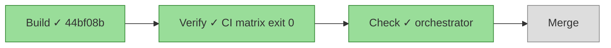

# 072 The mobile menu's hidden test reads the attribute

status: building · rank: 1 · level: simple · type: test · session: none

## Summary
The test `the_mobile_menu_is_hidden_when_a_page_loads` in src/shell.rs was matching "hidden" anywhere in the tag, including the class `sm:hidden`, so it could not fail when the attribute was removed. The fix uses the `tag_with` helper to extract the opening tag of `#pc-menu` and asserts ` hidden` (with leading space) as an attribute. This matches the pattern used by the 070 test `the_menu_has_no_hidden_attribute_only_when_open`.

## Workflow

## Log
| Step | Result | Output |
| --- | --- | --- |
| Build | done | 44bf08b; green under mutation before (test exit 0), red after (test FAILED); checks: fmt 0, leptosfmt 0, clippy ssr/hydrate/csr/browser 0/0/0/0, test exit 0, doc exit 101 (pre-existing src/language.rs broken-intra-doc-links not related to this change) |
| Check | done | orchestrator: the diff read (`tag_with` on #pc-menu, ` hidden` with its leading space); green under the inverted condition before, red after; the lane's doc 101 came from a non-CI invocation: `cargo doc --locked --no-deps --features ssr` with -D warnings exits 0 (orchestrator); the broken intra-doc link in language.rs under other feature sets becomes task 073 |
