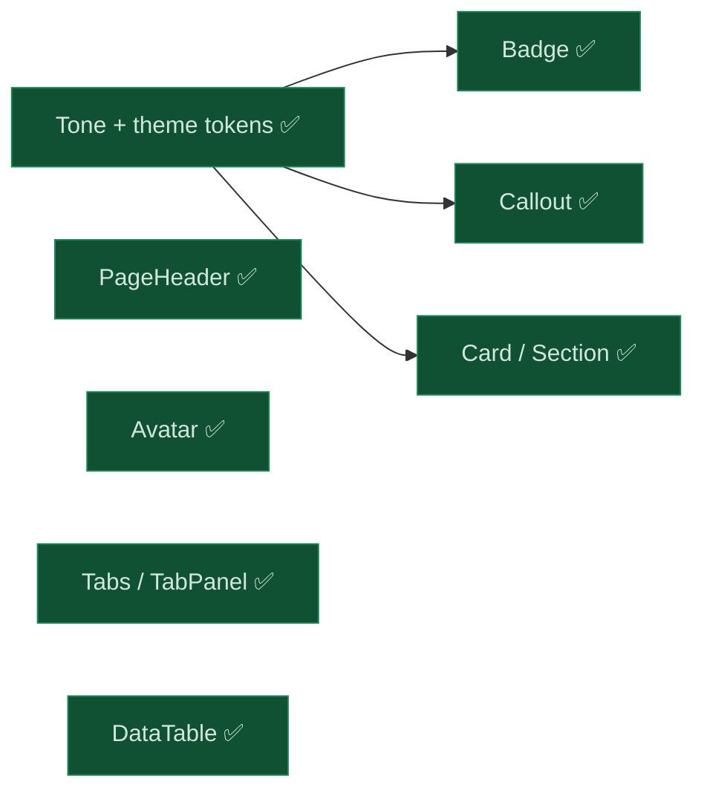

# 079 The display components a console needs — Badge, Avatar, Card, Section, PageHeader, Callout, Tabs, DataTable

status: user check · rank: 5 · level: standard · type: feat · request: anatta-console 096 (the console rebuilt as a Leptos SPA; the user, 2026-10-24) · session: ui-lib-078-display-components (workspace ui-lib; opened as 078 before the collision, see the Log)

## Summary
The anatta console is rebuilt as a Leptos SPA from a mockup the user validated (claude.ai/artifact/3fF6JfWYjQzvPqEdV3i4Me). The user wants every generic piece in ui-lib, "réutilisable et paramétrable", built directly here (no ui-lab incubation; the gallery page still shows them). Rank 5: difficulty 3 (eight components, two stateful), impact 3 (additive, every service unchanged), signals: a theme change, a contrast finding.

Decided: one `Tone` vocabulary (`#[non_exhaustive]`) over new theme tokens; `Badge`, `Avatar`, `Card`, `Section`, `PageHeader`, `Callout`, `Tabs`/`TabPanel`, `DataTable`/`Column`; six icons (`Info`, `Warning`, `Copy`, `More`, `Mail`, `Shield`); three library strings (`callout_dismiss`, `table_empty`, `table_truncated`, `table_actions` — four) in en, fr, vi. Ruled out: a colour or style prop (a scan test refuses one); one big Table with every option. Found: the dark `--ps-danger` reaches 4.39:1 on a card — kept (a look services use), danger text goes through a new `--ps-danger-text`; a follow-up for the services' own danger text. Surfaces: theme.css (additive tokens), icon.rs (new variants), lib.rs re-exports. Out: inputs, Switch, CopyField, Toast, ConfirmBox, NavRail (079).

## Design
Viewer: ui-lib-079-display-components/design v2, after deep's review #14991 (all nine points taken).

## Log

| Step | Result |
| --- | --- |
| Define | Design v1 from the mockup; deep #14991: nine points (three tone enums, DataTable re-renders and key contract, SSR/hydration of empty, two truncations, Callout's dismiss outside Button, Tabs ids/keys/unknown value, Avatar precedence and broken image, locale parity, README count, no net for the refusals) — all in v2 |
| Build | Tone + tokens (every block) + Badge; Card, Section, PageHeader, Avatar, Callout; Tabs (+ normalisation of an unknown value, red by mutant); DataTable (keyed For, debug_assert on duplicates). Tests: tone looks distinct and token-only; tone text at AA on every opaque surface of every block — it found dark `--ps-danger` at 4.39:1, hence `--ps-danger-text`; the light token table extended by the eight; a source scan refusing a hex or a colour prop (probed: a planted `bg-[#ff0000]` goes red). clippy ssr / hydrate / csr / browser clean; rustdoc clean; ssr tests green |
| Look | Gallery page Data (ui-lab, paired worktree wt/079) served on :3078 and screenshotted by headless Chrome, light, dark and 390 px: one defect seen and fixed — a picture failing BEFORE hydration showed a broken image (its error fired with no handler): an Effect reads `complete && naturalWidth == 0` once mounted. The phone shot's right-edge clipping is the headless window's minimum width (an existing page, /cards, clips the same) |
| Review 1 | deep #15013 on 5e70b0c, 12 rows, rulings #15021: FIXED — TabPanel built only while shown, no write during render (a Memo), one TabSet for tabs and panels, the painted pairs tested composited (it failed twice: `--ps-danger-text` dark #ec9a9a / light #a33333, a new `--ps-accent-soft`), the scan sees palette / colour arbitrary / style, Callout's close hides it, Section's title for any tone, `unreachable!` for a mis-routed icon (the existing every-icon test lists the six), TabOption `#[non_exhaustive]`; DOC — the browser gate, a link card holds no interactive content. Fix e911b9f; mutant on TabPanel's Show red. 540 tests |
| Review 2 | deep #15022 on e911b9f: rows 1–3, 7–9, 12 closed, 4–5 in substance; bounded fixes 046af91 (indentation, has_hex digits, three contracts documented); Section's title on the card already under the first contrast test. Rulings #15025. Closed at the cap |
| Look 2 | Gallery restarted on the fix: light and dark checked by eye (accent badge, danger text) |

| Renumber | At merge, ui-lib main held another 078 (learn-pali 072's `--ps-success`, 1 token, tagged v0.4.5 and pushed) taken while this task was open — theme.css was a shared surface neither task named. This task became 079, re-applied on main (one squash, one conflict in theme.css and theme.rs): main's `--ps-success` values kept (#7fc98f dark, #286b40 light — released, learn-pali uses them), `--ps-success-soft` recomputed from them; the viewer session keeps its 078 name; release v0.4.6 |

## Residuals

| Residual | Owner |
| --- | --- |
| A duplicate DataTable key is a `debug_assert` only: in release two rows swap (documented caller contract) | accepted |
| The dark `--ps-danger` is 4.39:1 on a card — kept as the services' fill; their own danger TEXT should move to `--ps-danger-text` | follow-up, each service (search-front, learn-pali) |
| `leptosfmt --check` rewrites `src/pali_text.rs` on main (one line, outside 079) | follow-up, ui-lib |
| The phone shot of the gallery is clipped by headless Chrome's minimum window width (an existing page, /cards, clips the same) | none: a tool limit, not the components |

## Merge
