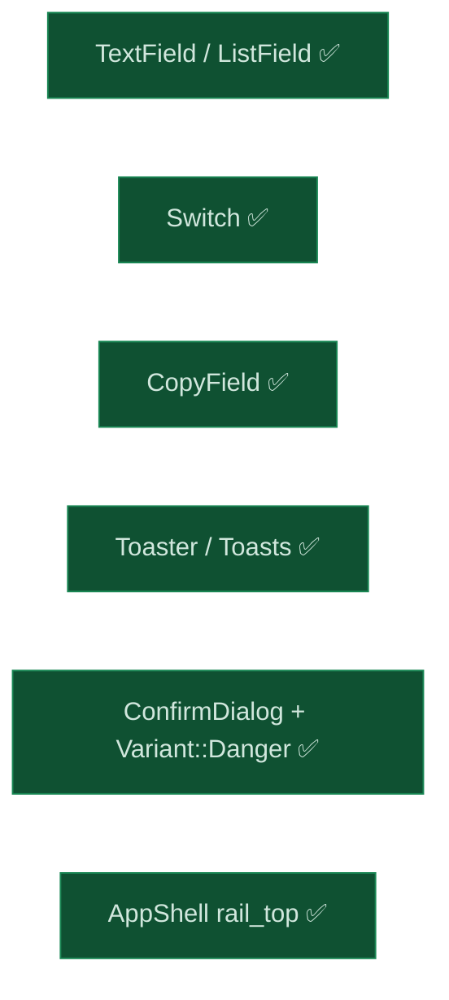

# 080 The input and feedback components a console needs — TextField, ListField, Switch, CopyField, toasts, ConfirmDialog

status: merged · rank: 5 · level: standard · type: feat · request: anatta-console 096 (the SPA), after 079 · session: ui-lib-080-input-components (workspace ui-lib) · number: working, re-checked against main at merge (lesson 2026-10-24)

## Summary
The second half of what the anatta console's SPA needs from ui-lib, generic and parametrable (user, 2026-10-24). Rank 5: difficulty 3 (six components, browser timers and focus), impact 3 (additive; one enum made non-exhaustive, no service matches it). Shared surfaces named at open and grepped against main and every open branch: button/style.rs, shell.rs, locales, lib.rs — no open branch touches them recently.

Decided: `TextField` and `ListField` (rows carry their own id; Remove named by content; focus after remove next/previous/Add); `Switch`; `CopyField` (Clipboard API plus selection, a `Tone` edge); `Toaster` (two live regions, 5 s paused on hover/focus, timers cleaned, a missing provider panics naming the fix); `ConfirmDialog` (require_text, pending, error, text cleared on close); `Variant::Danger` with `Variant` `#[non_exhaustive]`; `AppShell`'s `rail_top` slot, called once per `SlotPlace`. Ruled out: a field that validates by itself; a toast that leaves while held; a second rail component (AppShell already is one).

## Design
Viewer: ui-lib-080-input-components/design v2, after deep #15051 (nine points, all taken).

## Log

| Step | Result |
| --- | --- |
| Define | Design v1; deep #15051: the slot rendered twice, ListField id ownership and position names, one region cannot change politeness, no pending in the confirm, no on_input, Variant not non_exhaustive, no locale node, bools for appearance, tests on what cannot break — all in v2 |
| Build | Variant::Danger (+ the Danger button's label at AA in every block); field.rs, switch.rs, copy_field.rs, toast.rs, confirm.rs; AppShell rail_top. Found while building: (1) a toast's timer started at render reached wasm-bindgen on the server and aborted the test process — timers are browser-only; (2) a prop named `slot` on DesktopRail and MobileNav made Leptos drop both components from the render, silently — 69 existing shell tests caught it; renamed `top`. The colour scan covers the five new files. clippy ssr/hydrate/csr/browser, rustdoc, cargo fmt and leptosfmt clean; 557 ssr tests |
| Look | Gallery page Forms (ui-lab, wt/080) on :3080, headless Chrome dark: fields, a line error under its line, switches, copy fields, danger buttons, a composed settings screen; the dialog and two toasts opened on load for one shot (page restored after): the confirm disabled until the name is typed, toasts bottom right |
| Review 1 | deep #15064 on 417f428, 7 rows, rulings #15069: FIXED — CopyField's success from the promise, ConfirmDialog's double act and focus (a hold, aria-disabled, a live region), the rail slot kept mounted, the phantom row id, ListField on_input, Switch pending; RESIDUAL — ConfirmDialog's `&'static` id (Dialog's), the toast's full restart. Fix f2df6bc |
| Review 2 | deep #15070: the fix opened a regression — with no `pending`, one click left the confirm inert until a close. Same class, one bounded fix (9fab0f1: an error releases the hold; the copy settles once, its timer after the answer, an insecure origin Selected at once; Switch aria-disabled; no 'line 1' on a removed line) and one bounded pass (deep #15073): closed, plus late clipboard writes made no-ops after unmount (fa33ab5). 558 tests, clippy four targets, rustdoc, both formatters clean |

## Residuals

| Residual | Owner |
| --- | --- |
| ConfirmDialog's id is `&'static str` (Dialog and Disclosed take one) | a Dialog change, later |
| A caller that fails without setting `error` (or sets the same message twice without clearing) leaves the confirm held until a close — documented | caller contract |
| No interim state on the Copy button during a slow permission prompt | low |
| A removed line's input is nameless for one frame | low |
| `aria-disabled:` states exist on Primary and Danger only | when another variant needs them |
| A hovered toast restarts its full 5 s | low |
| ListRow ids are per process: a list rendered on the server is rebuilt on hydration | documented; the console's SPA builds rows in the browser |

## Merge

cdf77cb, released v0.4.7 (the number and the version checked against main at merge: free)

## Retro

Errors: (1) a prop named `slot` on two child components silently dropped them from the render — Leptos reserves the name; caught only because the shell has 69 tests; (2) a review-1 fix (the confirm's hold) introduced a regression for callers with no `pending`, caught in round 2 — a fix that adds state needs the same "who releases it" question as the design; (3) browser timers started at render reached wasm-bindgen on the server; (4) leptosfmt and cargo fmt fought over three files until run in that order; (5) three scripted edits missed anchors after formatting, each caught by its assertion. What held: the number and version checked at merge (the 079 lesson), every guard probed, the dialog and toasts opened for one screenshot.

Lessons: in Leptos, never name a component prop `slot`; a fix that holds state names its release in the same commit (on success, failure and close).
